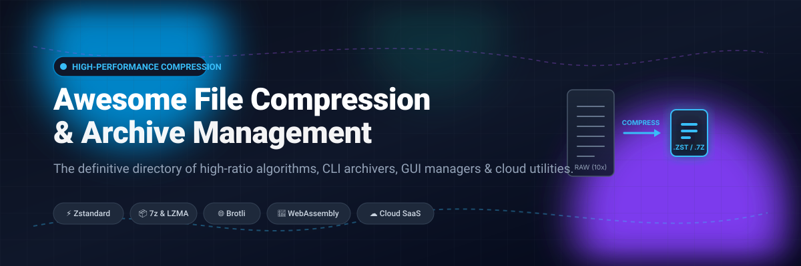

# 📦 Awesome File Compression & Archive Management 🗜️

  

  
  
  
  
  
  

---

## 🌟 Overview & Highlights

A curated directory and developer guide to top-tier **open-source file compression tools**, **archive managers**, **high-throughput CLI utilities**, **state-of-the-art compression algorithms (Zstd, Brotli, LZ4, Deflate, Snappy)**, and **cloud SaaS archive extraction platforms**. Optimized for developers, DevOps engineers, system administrators, and storage architects seeking optimal compression ratios, maximum decompression bandwidth, and efficient storage pipelines.

---

## 📑 Table of Contents

- [📊 Sector Overview & Market Dynamics](#-sector-overview--market-dynamics)
- [☁️ SaaS / Hosted Platforms](#️-saas--hosted-platforms)
- [🔓 Open-Source Software](#-open-source-software)
  - [🖥️ Desktop GUI Archive Managers](#️-desktop-gui-archive-managers)
  - [⚡ Compression Algorithms & Core Libraries](#-compression-algorithms--core-libraries)
  - [💻 Command-Line (CLI) Archivers & Data Utilities](#-command-line-cli-archivers--data-utilities)
  - [🌐 Web-Based, WebAssembly & Browser Extractors](#-web-based-webassembly--browser-extractors)
- [📈 Star History](#-star-history)
- [💖 Support & Sponsorship](#-support--sponsorship)
- [🤝 Contributing](#-contributing)
- [📄 License](#-license)

---

## 📊 Sector Overview & Market Dynamics

The global data compression and deduplication software sector is estimated at **$1.8 billion to $2.4 billion** (projected to reach over **$4.2 billion by 2032** growing at a **~6.8% CAGR**), driven by surging cloud egress costs, massive AI dataset pipelines, and hyperscale storage footprints.

Market dynamics exhibit a clear **hybrid bifurcation**: the end-user consumer and desktop archiver segment is **highly fragmented** with low barriers to entry and intense competition among independent freemium and open-source utilities (7-Zip, PeaZip, WinRAR, Keka), whereas the enterprise cloud backend, database compression, and high-performance streaming tier is **moderately concentrated** around foundational standard algorithms (Meta’s Zstandard, Google’s Brotli/Snappy) and hyperscale cloud storage providers.

---

## ☁️ SaaS / Hosted Platforms

| Product | Description | Company Size (Valuation / Revenue) | Starting Pricing | Free Tier / Trial Limits |
| :--- | :--- | :--- | :--- | :--- |
| [WinZip](https://winzip.com) | Commercial file archiver and cloud storage compression suite for Windows and macOS. | **~$1 Billion** (Acquired by KKR for $1B; estimated parent revenue ~$100M+) | $34.95 (one-time standard license) / ~$10/mo billed annually | 21-day free trial (no credit card required; locks access after 21 days) |
| [WinRAR](https://win-rar.com) | Commercial proprietary archive manager for Windows famous for native RAR creation and recovery records. | **~$15M – $30M Annual Revenue** (~$100M+ theoretical valuation; €1M+ annual net profit) | $29.00 (one-time perpetual single-user license) | 40-day free trial (full functionality with reminder prompts upon trial expiration) |
| [CloudConvert](https://cloudconvert.com) | Cloud-based file converter and archive utility supporting ZIP, RAR, 7Z, TAR, GZ, and BZ2 conversions via web UI and API. | **~$1M – $5M ARR** (Private, Bootstrapped / Lunaweb GmbH) | $9.00/month (1,000 monthly conversion credits) or $17.00 one-time credit package | Free forever plan with 10 conversion credits/day, max 1 GB file size, 5 concurrent tasks, and 5 minutes/conversion |
| [Bandizip](https://bandisoft.com) | Lightweight, fast Windows and macOS archiver featuring multi-core compression and archive repair (Freemium/Proprietary). | **~$900K – $3M Annual Revenue** (1.2B – 4B KRW; Bandisoft) | $30.00 (one-time single-user license) | Free forever standard edition (includes ads; max 16 CPU threads; password manager, archive repair, and image preview disabled) |
| [123apps Archive Extractor](https://extract.me) | Free web application to extract over 70 types of compressed files including 7z, zipx, rar, tar, exe, and dmg. | **~$500K – $2M Annual Revenue** (Bootstrapped / 123apps LLC) | $6.00/month (or $48/year billed annually) | Free forever plan with up to 10 GB file size limit, ad-supported, and standard processing speed |
| [Convertio Archive Converter](https://convertio.co) | Hosted cloud platform for converting between various archive formats seamlessly. | **~$500K – $2M Annual Revenue** (Private / Convertio Ltd.) | $9.99/month (Light plan with 500 MB max file size and 25 concurrent conversions) | Free forever plan with up to 100 MB file size limit and 10 conversion credits per 24 hours |
| [ezyZip](https://ezyzip.com) | Free online browser-based file compression and extraction utility that processes files locally without server uploads. | **~$100K – $500K Annual Revenue** (Indie SaaS & Ad-supported) | $18.00/month (or $54/year, $98 lifetime access for ezyZip Pro) | Free forever plan with up to 2 GB file size limit, ad-supported, standard browser WebAssembly processing |

---

## 🔓 Open-Source Software

### 🖥️ Desktop GUI Archive Managers

* [NanaZip](https://github.com/M2Team/NanaZip)  - Open-source 7-Zip derivative intended for the modern Windows experience, with MSIX packaging and Windows 11 context menu integration.
* [PeaZip](https://github.com/peazip/PeaZip)  - Free, cross-platform file archiver and zip utility supporting over 200 archive formats with strong 256-bit AES encryption.
* [7-Zip-zstd](https://github.com/mcmilk/7-Zip-zstd)  - Standard 7-Zip enhanced with support for modern codecs including Zstandard, Brotli, LZ4, LZ5, Lizard, and Fast-LZMA2.
* [Keka](https://github.com/aonez/Keka)  - Full-featured, powerful macOS file archiver supporting 7z, Zip, Tar, Gzip, Bzip2, XZ, Lzip, DMG, and ISO formats.
* [p7zip](https://github.com/p7zip-project/p7zip)  - Modern POSIX and Linux port of 7-Zip command line archiver with updated codec integration.
* [7-Zip](https://7-zip.org) - Renowned open-source file archiver featuring the highest compression ratio via native `.7z` and LZMA/LZMA2 algorithms. ([Source Code](https://github.com/jinfeihan57/p7zip))
* [Ark](https://apps.kde.org/ark/) - KDE’s graphical archive manager utility supporting multi-volume archives and tarballs with desktop integration. ([Source Code](https://invent.kde.org/utilities/ark))
* [File Roller](https://wiki.gnome.org/Apps/FileRoller) - Default GNOME graphical archive management frontend for viewing and extracting compressed archives. ([Source Code](https://gitlab.gnome.org/GNOME/file-roller))
* [Engrampa](https://github.com/mate-desktop/engrampa) - Lightweight archive manager for the MATE desktop environment based on File Roller.
* [Xarchiver](https://github.com/ib/xarchiver) - Desktop-independent lightweight GTK+ frontend supporting 7z, ARJ, bzip2, gzip, RAR, LHA, tar, and zip.

### ⚡ Compression Algorithms & Core Libraries

* [Zstandard (zstd)](https://github.com/facebook/zstd)  - Fast real-time lossless compression algorithm developed by Meta, offering extreme speed and high compression ratios.
* [Brotli](https://github.com/google/brotli)  - Generic-purpose lossless data compression algorithm developed by Google, delivering superior density for web assets.
* [LZ4](https://github.com/lz4/lz4)  - Extremely fast lossless compression algorithm achieving decompression speeds exceeding multi-GB/s per core.
* [Draco](https://github.com/google/draco)  - Open-source library by Google for compressing and decompressing 3D geometric meshes and point clouds.
* [zlib](https://github.com/madler/zlib)  - Foundational, massively popular compression library implementing DEFLATE, ubiquitous across OS kernels and network stacks.
* [Snappy](https://github.com/google/snappy)  - High-speed, low-CPU compression library engineered by Google for Bigtable and distributed storage engines.
* [libarchive](https://github.com/libarchive/libarchive)  - Multi-format streaming C archive and compression library powering `bsdtar`, `tar`, and POSIX unarchivers.
* [Zopfli](https://github.com/google/zopfli)  - State-of-the-art Deflate/Gzip compression algorithm producing smaller output files than standard zlib at maximum quality.
* [miniz](https://github.com/richgel999/miniz)  - Single-source-file, header-only C zlib replacement library supporting zip archive reading and writing.
* [LZFSE](https://github.com/lzfse/lzfse)  - Apple's Lempel-Ziv Finite State Entropy compression library engineered for high performance and low energy usage.
* [libdeflate](https://github.com/ebiggers/libdeflate)  - Heavily optimized C library for ultra-fast whole-buffer DEFLATE, zlib, and gzip compression and decompression.
* [Smaz](https://github.com/antirez/smaz)  - Efficient small string compression library written by Salvatore Sanfilippo (creator of Redis).
* [lzbench](https://github.com/inikep/lzbench)  - In-memory multi-codec benchmark suite measuring speed and compression ratios across dozens of open-source compressors.
* [libzip](https://github.com/nih-at/libzip)  - Portable C library for reading, creating, and modifying ZIP archives with support for encrypted archives.
* [cloudflare-zlib](https://github.com/cloudflare/zlib)  - Cloudflare's optimized fork of zlib delivering up to 2x speedups using AVX and modern assembly.
* [c-blosc2](https://github.com/Blosc/c-blosc2)  - Fast, compressed, persistent binary data store and multi-threaded compression engine optimized for NumPy and PyTables.
* [XZ Utils](https://github.com/tukaani-project/xz)  - Free general-purpose data-compression software with a very high compression ratio based on LZMA/LZMA2.
* [Lzip](https://www.nongnu.org/lzip/) - Lossless data compressor based on the LZMA algorithm featuring a simplified format and rigorous 3-factor integrity verification.

### 💻 Command-Line (CLI) Archivers & Data Utilities

* [ouch](https://github.com/ouch-org/ouch)  - Modern and painless CLI archive utility written in Rust supporting `.tar`, `.zip`, `.bz`, `.xz`, `.lzma`, `.gz`, and `.zst`.
* [pigz](https://github.com/madler/pigz)  - Multi-threaded parallel implementation of gzip exploiting multi-core CPUs for blazingly fast compression.
* [kuba-zip](https://github.com/kuba--/zip)  - Minimalist, portable C library and command-line utility for manipulating ZIP files with no external dependencies.
* [pixz](https://github.com/vasi/pixz)  - Parallel, indexed XZ compressor for multi-threaded compression and rapid random-access tarball decompression.
* [patool](https://github.com/wummel/patool)  - Portable command-line archive file manager written in Python supporting over 30 distinct archive formats.
* [dtrx](https://github.com/brianm/dtrx) - Intelligent "Do The Right Extraction" CLI tool that uncompresses nested archives safely without cluttering directories.
* [GNU Tar](https://www.gnu.org/software/tar/) - The canonical POSIX tape archiver utility powering backups, package management, and system distribution.
* [Info-ZIP](http://infozip.sourceforge.net/) - Historic portable open-source utilities (`zip` and `unzip`) for cross-platform archive processing.
* [atool](https://www.nongnu.org/atool/) - Unified command-line script for managing archives of various formats (`aunpack`, `apack`, `als`, `acat`).
* [zpaq](http://mattmahoney.net/dc/zpaq.html) - Incremental journaling archiver offering deduplication and massive compression ratios for multi-terabyte backups.
* [dar](http://dar.linux.free.fr/) - Disk ARchive utility designed for full and differential backups, slicing, encryption, and fast selective file restores.
* [plzip](https://www.nongnu.org/lzip/plzip.html) - Massively parallel multi-threaded lossless data compressor based on the high-ratio lzip file format.

### 🌐 Web-Based, WebAssembly & Browser Extractors

* [JSZip](https://github.com/Stuk/jszip)  - Robust JavaScript library to create, read, and edit `.zip` files directly within browsers or Node.js.
* [zip.js](https://github.com/gildas-lormeau/zip.js)  - High-performance JavaScript library for zipping and unzipping files in the browser using Web Workers and Streams.
* [fflate](https://github.com/101arrowz/fflate)  - Lightest and fastest pure JavaScript compression and decompression library in an 8kB bundle.
* [libarchivejs](https://github.com/bstdlib/libarchivejs)  - WebAssembly port of `libarchive` enabling client-side browser extraction of 7z, RAR, TAR, GZIP, and ZIP archives.
* [FileSaver.js](https://github.com/eligrey/FileSaver.js)  - Standard HTML5 client-side solution for saving extracted files and generated archives in the browser.

---

## 📈 Star History

---

## 💖 Support & Sponsorship

If you found this directory helpful for your workflows, projects, or research, please consider supporting the project:

- ⭐ **Star this repository** to help others discover it!
- 🍴 **Fork the repo** to contribute your favorite algorithms, CLI tools, and benchmarks.
- 📣 **Share with your team**, storage architects, and DevOps peers.
- ☕ **Buy me a coffee / Sponsor**: If you'd like to support continued maintenance and curation of open-source resources, please visit the [GitHub Sponsors Dashboard](https://github.com/sponsors/ishandutta2007). Your support is deeply appreciated!

---

## 🤝 Contributing

Contributions are warmly welcome! If you know of an outstanding open-source compression library, CLI utility, high-performance algorithm, or hosted platform:

1. 🍴 Fork this repository.
2. 🌿 Create a new feature branch (`git checkout -b add-my-tool`).
3. 📝 Add your tool under the appropriate category with a concise description and GitHub star badge.
4. 🚀 Submit a Pull Request with a clear summary of why it belongs here.

---

## 📄 License

To the extent possible under law, the contributors have waived all copyright and related or neighboring rights to this work under the [Creative Commons Zero v1.0 Universal](https://creativecommons.org/publicdomain/zero/1.0/) license.
